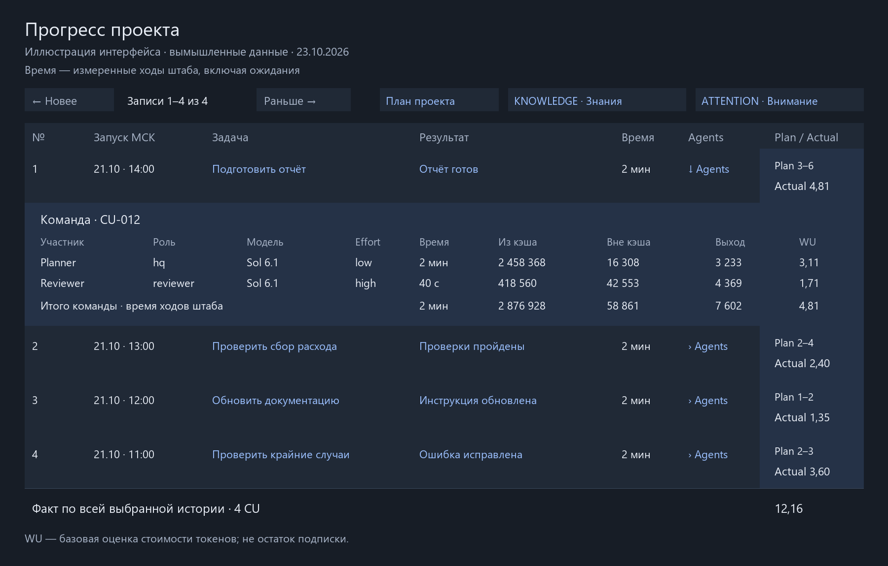

# Continuous Development: CD5 и MAC для Codex

Навыки для длительной работы с ИИ: **CD5** сохраняет ход проекта и показывает прогресс, **MAC** помогает подключать исполнителей и проверяющих, когда это полезно.

Все исходники навыков Codex находятся в [`codex/skills`](codex/skills). Это основное место их разработки; установленный каталог навыков — рабочая копия.

| Навык | Для чего нужен |
| --- | --- |
| [CD5](codex/skills/cd5/SKILL.md) | Один ответственный штаб, сохранённый контекст, Control Units, отчёт о прогрессе, прогноз и фактический расход WU. |
| [MAC](codex/skills/mac/SKILL.md) | Необязательная работа с агентами в общем бюджете. Один переключатель `auto/off`, проверка результатов и учёт участников. |

CD5 может работать одним агентом. Включение CD5 само по себе не включает MAC и не запускает работу.

## Быстрый старт

Склонируйте репозиторий:

```sh
git clone https://github.com/axo-ma/continous_development.git
cd continous_development
```

Затем дайте своему Codex такую инструкцию:

> Прочитай codex/README.md. Установи CD5 и MAC через codex/install.py в мой каталог навыков. Сохрани существующие настройки и резервные копии. Добавь нужные маршруты из codex/AGENTS.fragment.md, не заменяя остальные инструкции. Проекты и автоматизации пока не запускай.

Подробности, ручная установка и применение к существующему проекту — в [инструкции Codex](codex/README.md).

После настройки проекта можно написать штабу **«Продолжай работу»**, а позднее — **«Покажи прогресс»**. При первой настройке нужно сформулировать задачу и явно разрешить её начало. Отчёт можно запрашивать и из отдельного чата контроля того же проекта.

## Отчёт о прогрессе

Одна строка — одна **Control Unit (CU)**: понятный пользователю объём работы с ожидаемым результатом. Это не отдельная запись на каждый инструмент или сообщение.

Отчёт показывает задачу, результат, время, команду, прогноз и фактический расход **Work Units (WU)**. По кнопке «Команда» раскрываются участники, модели, effort, время и три вида токенов. Задача и результат открывают сохранённые подробности. Сначала видны последние десять CU; **«Раньше →» / «← Новее»** листают доступную историю.



*Иллюстрация интерфейса на вымышленных данных, а не журнал реального проекта. [Открываемый HTML-пример](codex/docs/examples/progress-report.html) использует настоящий генератор отчёта. Для просмотра скачайте HTML и откройте его в браузере.*

Примеры запросов:

```text
Покажи прогресс
Покажи прогресс за неделю
Покажи прогресс за всё время
```

**WU** — нормализованная базовая стоимость токенов по датированной таблице тарифов, а не остаток подписки Codex. Прогноз — ориентир; факт вычисляется из доступных журналов. Отдельный лимит поддерживается опционально, для начала пользоваться им не требуется. Старым CU прогнозы не придумываются.

Отчёт собирается кодом. Перелистывание и раскрытие сохранённых деталей не вызывают модель. У штаба остаются короткие отметки начала CU и результата; недоступные или неоднозначные измерения отображаются как неполные, не как ноль.

## Разработка

Изменения вносятся в `codex/skills`, проверяются, коммитятся и только затем устанавливаются. Не редактируйте одновременно несколько копий навыка и не переносите сюда журналы проектов, токены доступа или персональные настройки.

```sh
python codex/run_tests.py
python codex/examples/build_report.py
```

Для работы скриптов нужен Python 3.10+. Сам учёт и установка используют стандартную библиотеку; тесты JavaScript дополнительно используют Node.js, если он доступен. Иллюстрации в README уже включены в репозиторий.

Возможности агентов, квот, автоматизаций и интерактивного вывода зависят от доступных инструментов Codex. Навыки не добавляют отсутствующие API и сохраняют ограничения и остановки проекта.

### Просмотр памяти в отчёте

Кнопки **KNOWLEDGE · Знания** и **ATTENTION · Внимание** открывают сохранённые выводы и вопросы. В знаниях доступны поиск и страницы, во внимании — открытые вопросы и закрытая история. Это снимок на момент формирования отчёта. В таблице и подробностях CU отображаются **план и факт WU**; лимиты не выводятся. Пример в документации использует только синтетические данные.

Измеренные токены незавершённого хода показываются как **измеренная часть** с временем последнего наблюдения. Отсутствие длительности не скрывает токены. Участники регистрируются по точному пути задачи с проверкой native UUID и родителя; роль задаётся явно. Причина неизвестного прогноза для текущей работы записывается в CU через `budget --forecast-unknown-reason`, а не только в CHECKPOINT. Поздняя запись остаётся текущей ревизией и не становится первоначальным прогнозом.

Обзор отчёта помещается по ширине панели: короткие номера строк, компактные даты и план-факт. Полный CU ID, причины неизвестных оценок и измерения участников открываются по нажатию. На узком экране строки перестраиваются без боковой прокрутки.

Если итог команды неизвестен, но подтверждён расход единственного штаба, компактная строка показывает **«Штаб … WU»** и отдельно **«Итог команды —»**. Измеренную часть незавершённого хода обозначает ≥; она не выдаётся за итог команды. Сквозной тест проверяет реальные CLI-команды открытия/завершения двух CU, запись разных числовых планов, чтение native-подобного журнала и формирование отчёта.
